# DEN Global — all pages and dashboards

86 captured screens across 12 review groups. These are screenshots of the working local UI using isolated synthetic accounts/data. They do not grant account access or expose a public role selector.

## Browse locally

From this repository run `python3 -m http.server 8790 --bind 127.0.0.1 --directory preview`, then open http://localhost:8790. Use the group buttons, page list, search, Previous/Next, or arrow keys.

## Browse on GitHub

Each link below opens the actual captured page. All eight workspaces and the four administrator types are covered; repeated account pages are shown per role. Main registration/edit/checkout/order-detail/receipt forms are included.

## Account entry

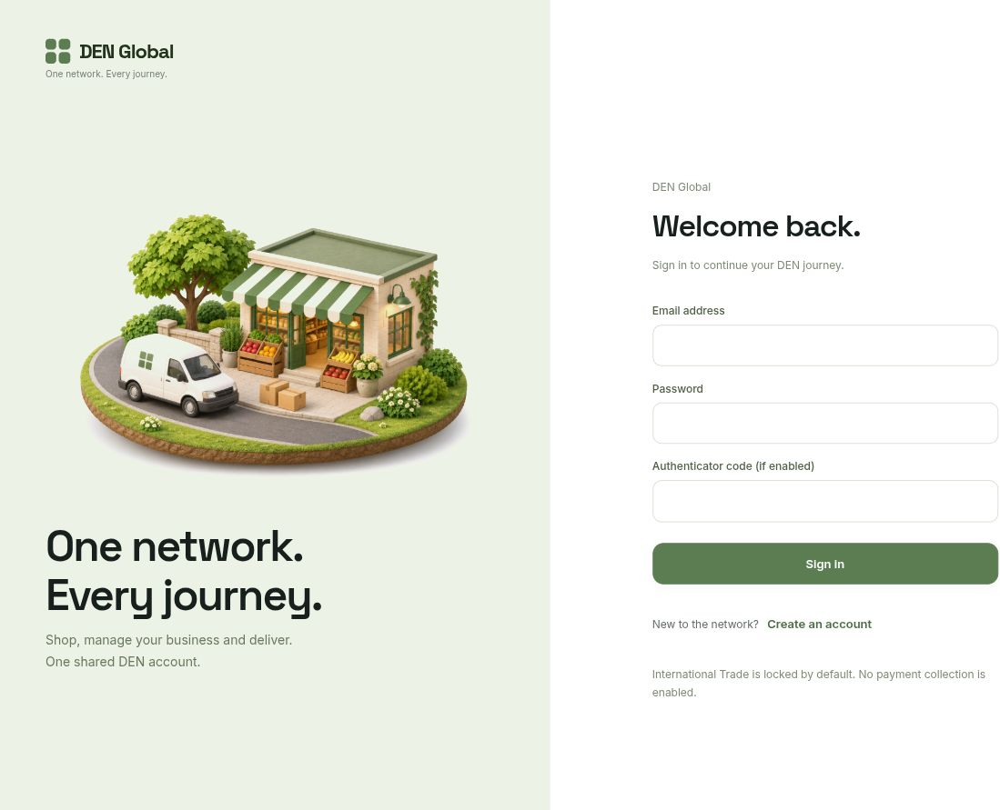

- [Common sign-in](screens/signin.jpg)
- [Create account: phone and address](screens/registration.jpg)

## Consumer

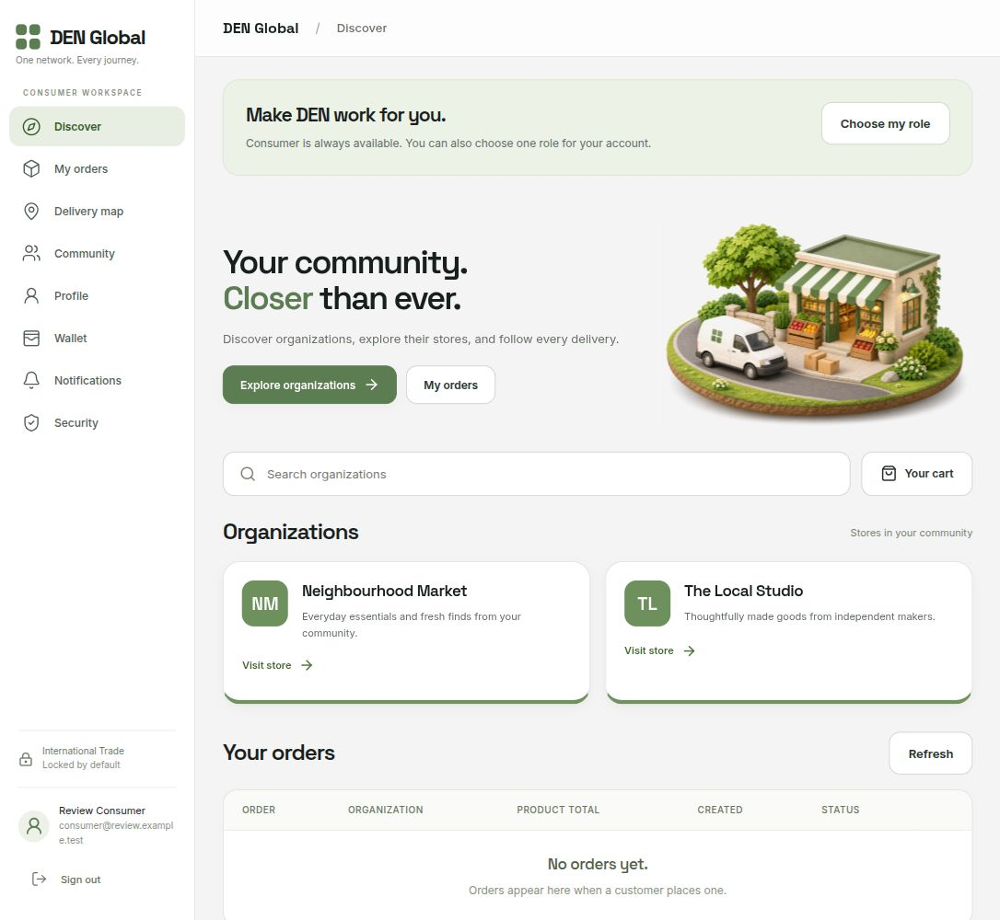

- [Discover and organizations](screens/consumer-discover.jpg)
- [Cart and checkout](screens/consumer-cart.jpg)
- [Choose one additional role](screens/consumer-role-choice.jpg)
- [Combined product and delivery receipt](screens/consumer-receipt.jpg)
- [Community](screens/consumer-community.jpg)
- [Delivery map](screens/consumer-delivery-map.jpg)
- [My orders](screens/consumer-my-orders.jpg)
- [Notifications](screens/consumer-notifications.jpg)
- [Order details and delivery verification](screens/consumer-order-detail.jpg)
- [Organization storefront](screens/consumer-store.jpg)
- [Product details and discussion](screens/consumer-product.jpg)
- [Profile](screens/consumer-profile.jpg)
- [Saved delivery destinations](screens/consumer-destinations.jpg)
- [Security](screens/consumer-security.jpg)
- [Wallet](screens/consumer-wallet.jpg)

## Manager

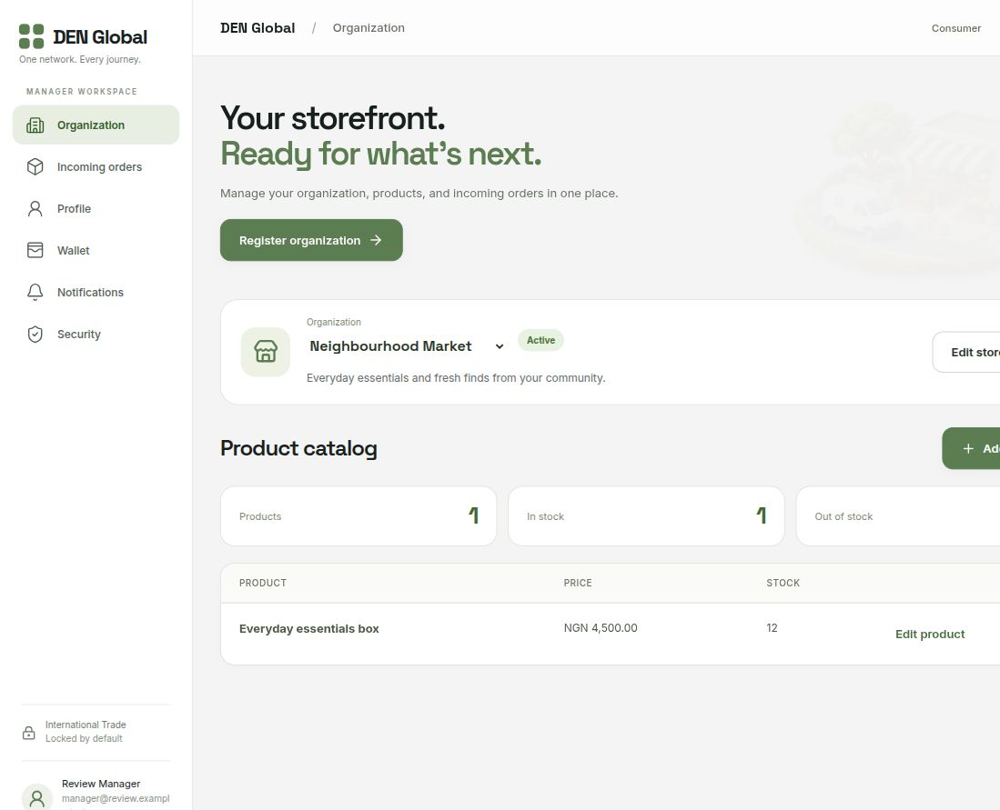

- [Organization](screens/manager-organization.jpg)
- [Add product](screens/manager-add-product.jpg)
- [Edit product](screens/manager-edit-product.jpg)
- [Edit store](screens/manager-edit-store.jpg)
- [Incoming orders](screens/manager-incoming-orders.jpg)
- [Notifications](screens/manager-notifications.jpg)
- [Profile](screens/manager-profile.jpg)
- [Register](screens/manager-register.jpg)
- [Security](screens/manager-security.jpg)
- [Wallet](screens/manager-wallet.jpg)

## Rider

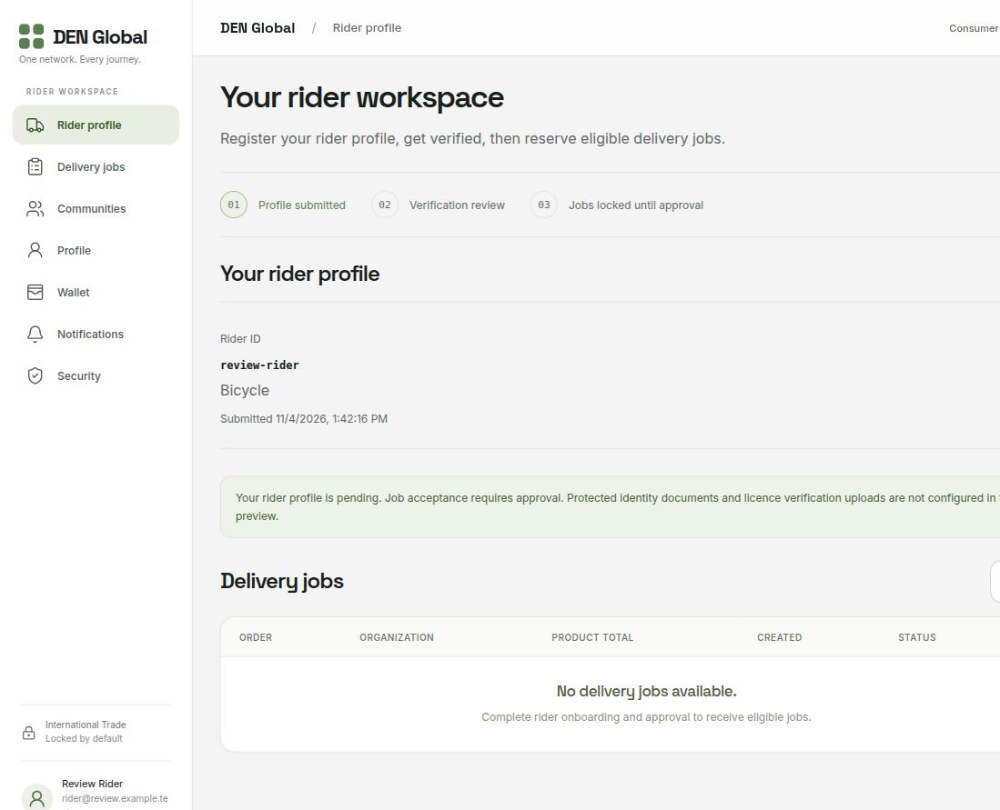

- [Rider profile](screens/rider-rider-profile.jpg)
- [Communities](screens/rider-communities.jpg)
- [Delivery jobs](screens/rider-delivery-jobs.jpg)
- [Notifications](screens/rider-notifications.jpg)
- [Profile](screens/rider-profile.jpg)
- [Security](screens/rider-security.jpg)
- [Wallet](screens/rider-wallet.jpg)

## Dispatch

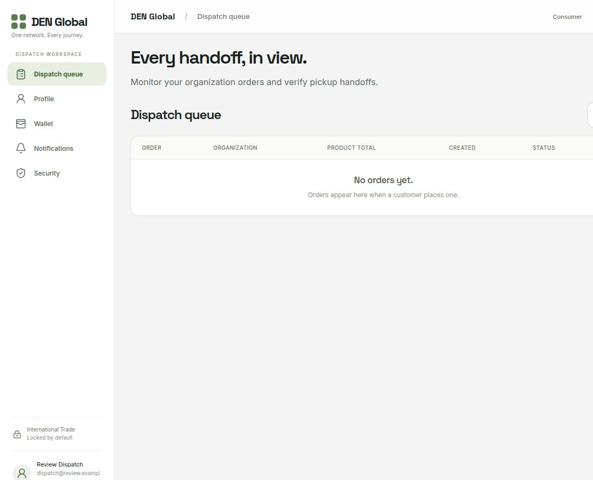

- [Dispatch queue](screens/dispatch-dispatch-queue.jpg)
- [Notifications](screens/dispatch-notifications.jpg)
- [Profile](screens/dispatch-profile.jpg)
- [Security](screens/dispatch-security.jpg)
- [Wallet](screens/dispatch-wallet.jpg)

## Transport

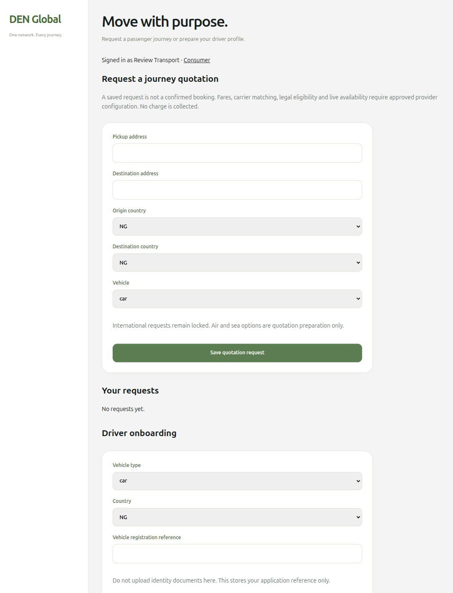

- [Journey requests and driver onboarding](screens/transport-dashboard.jpg)

## Shipment

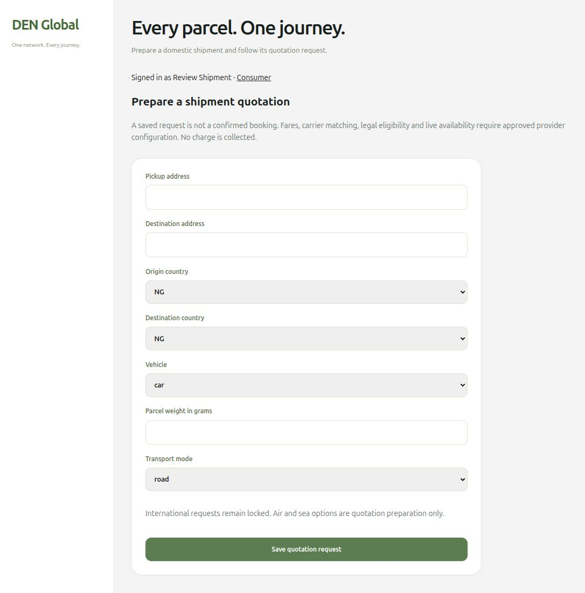

- [Shipment quotation requests](screens/shipment-dashboard.jpg)

## Warehouse

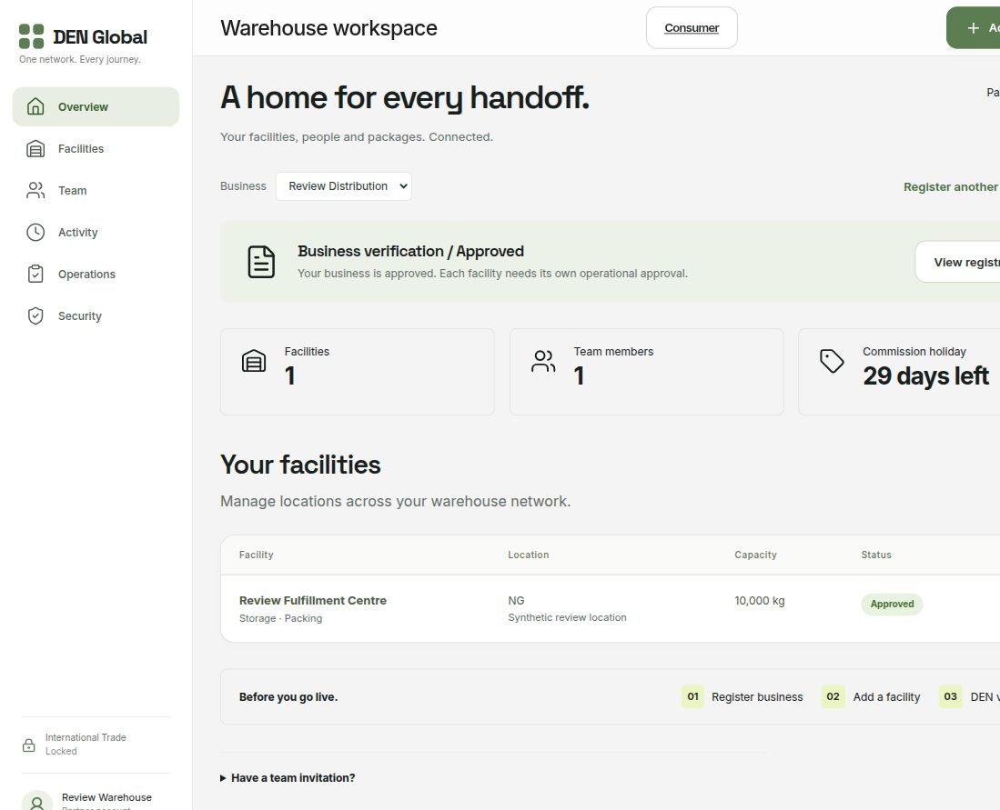

- [Overview](screens/warehouse-overview.jpg)
- [Activity](screens/warehouse-activity.jpg)
- [Add facility](screens/warehouse-add-facility.jpg)
- [Edit facility](screens/warehouse-edit-facility.jpg)
- [Facilities](screens/warehouse-facilities.jpg)
- [Invite](screens/warehouse-invite.jpg)
- [Operations](screens/warehouse-operations.jpg)
- [Register business](screens/warehouse-register-business.jpg)
- [Security](screens/warehouse-security.jpg)
- [Team](screens/warehouse-team.jpg)

## Owner Admin

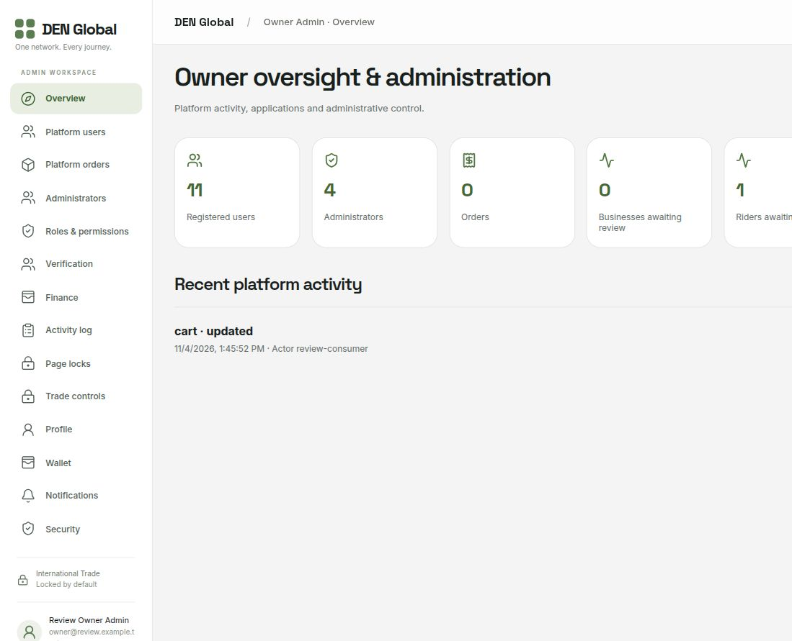

- [Overview](screens/owner-overview.jpg)
- [Activity log](screens/owner-activity-log.jpg)
- [Administrators](screens/owner-administrators.jpg)
- [Finance](screens/owner-finance.jpg)
- [Notifications](screens/owner-notifications.jpg)
- [Page locks](screens/owner-page-locks.jpg)
- [Platform orders](screens/owner-platform-orders.jpg)
- [Platform users](screens/owner-platform-users.jpg)
- [Profile](screens/owner-profile.jpg)
- [Roles & permissions](screens/owner-roles-and-permissions.jpg)
- [Security](screens/owner-security.jpg)
- [Trade controls](screens/owner-trade-controls.jpg)
- [Verification](screens/owner-verification.jpg)
- [Verification detail](screens/owner-verification-detail.jpg)
- [Wallet](screens/owner-wallet.jpg)

## Sub Admin

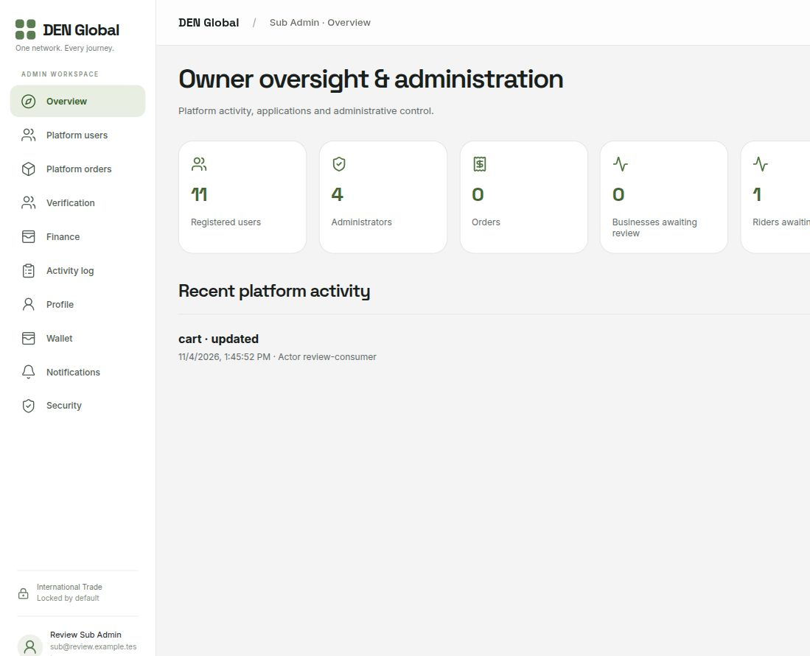

- [Overview](screens/sub-overview.jpg)
- [Activity log](screens/sub-activity-log.jpg)
- [Finance](screens/sub-finance.jpg)
- [Notifications](screens/sub-notifications.jpg)
- [Platform orders](screens/sub-platform-orders.jpg)
- [Platform users](screens/sub-platform-users.jpg)
- [Profile](screens/sub-profile.jpg)
- [Security](screens/sub-security.jpg)
- [Verification](screens/sub-verification.jpg)
- [Wallet](screens/sub-wallet.jpg)

## Finance Admin

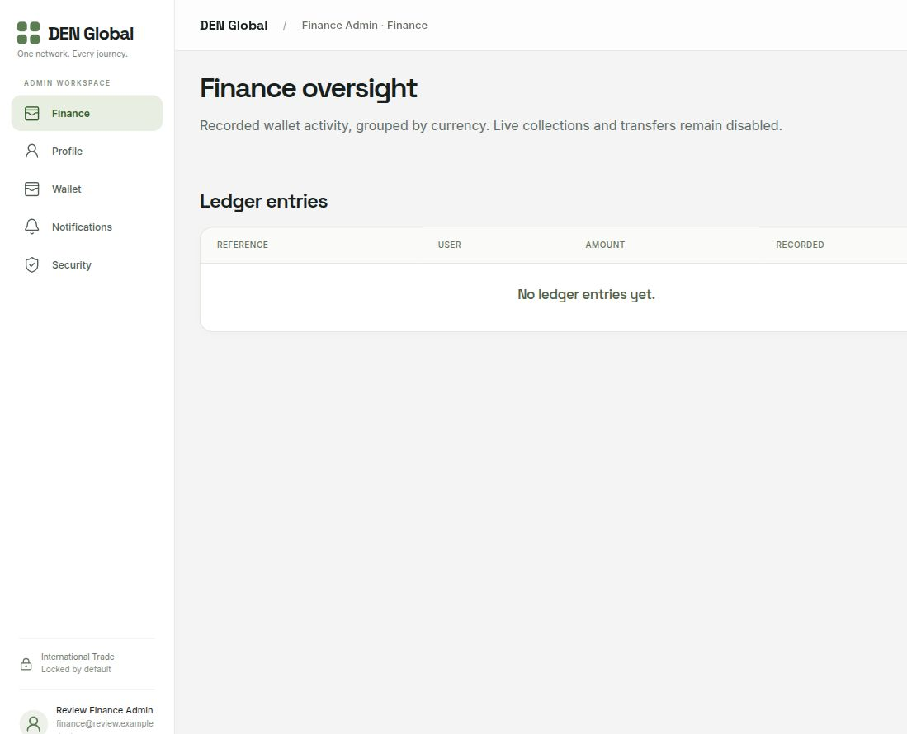

- [Finance](screens/finance-finance.jpg)
- [Notifications](screens/finance-notifications.jpg)
- [Profile](screens/finance-profile.jpg)
- [Security](screens/finance-security.jpg)
- [Wallet](screens/finance-wallet.jpg)

## Verification Admin

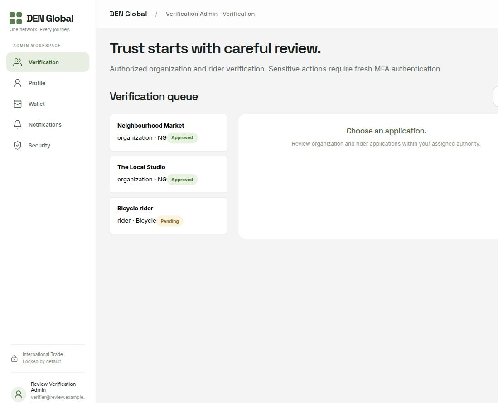

- [Verification](screens/verifier-verification.jpg)
- [Notifications](screens/verifier-notifications.jpg)
- [Profile](screens/verifier-profile.jpg)
- [Security](screens/verifier-security.jpg)
- [Wallet](screens/verifier-wallet.jpg)

## Validation and limits

Fresh backend run: 93 tests pass. All eight app builds pass, along with shared tests, vendor integrity checks, infrastructure configuration tests/static checks, and Transport/Shipment syntax checks. The browser exercised every captured navigation page and main forms. Admin review accounts signed in normally using MFA; Owner-only navigation was absent for subordinate accounts. A warehouse owner appearing in the membership list was double-counted; the count now de-duplicates IDs and the review shows one member correctly.

The screenshots are captured at different points in the isolated review session, so sample totals may differ between screens. No real financial/provider/email operation was performed. Real owner credentials were not installed or published. Existing provider configuration limits remain. The normal application at localhost:8787 keeps its original data and role policies. The temporary review server is separate from the screenshot gallery.
